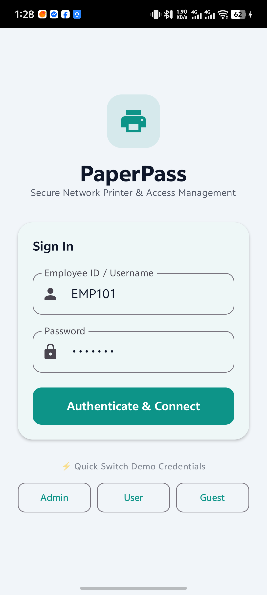
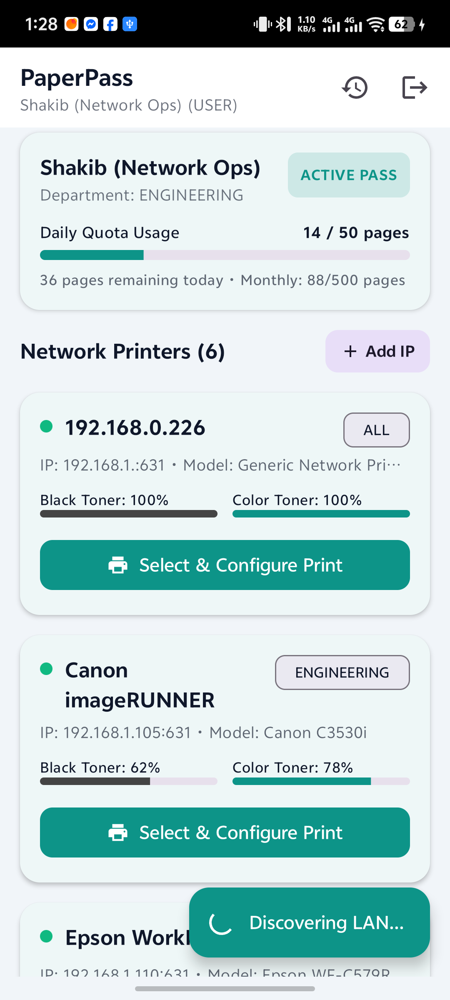
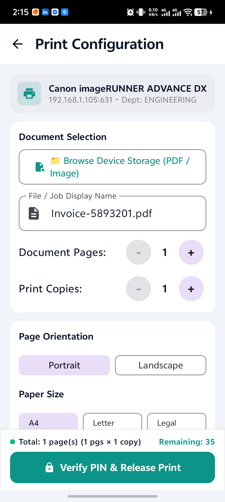
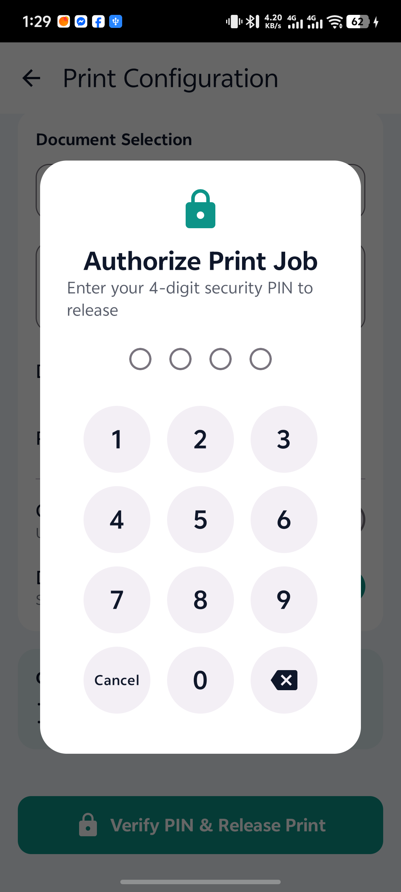
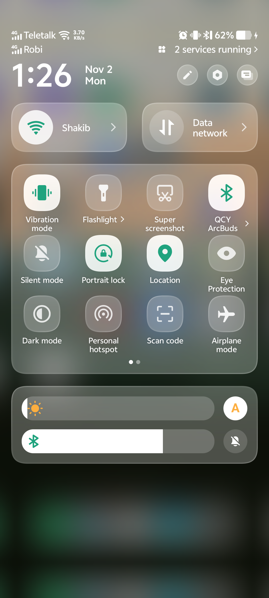
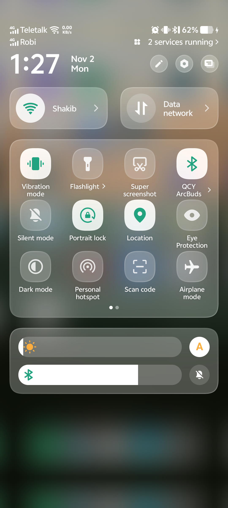
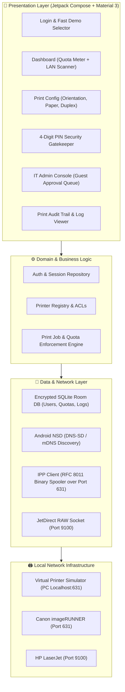

# 🖨️ PaperPass — Enterprise Network Printer Discovery & Access Management

[](#)
[](#)
[](#)
[](#)
[-FFA000.svg?logo=sqlite&logoColor=white)](#)
[](LICENSE)

> **Zero Unauthorized Prints. Total LAN Visibility.**  
> PaperPass transforms Android devices into secure, policy-enforced network printing terminals. It discovers office printers automatically on local subnets via **mDNS (Bonjour / Android NSD)** and enforces **strict authentication, 4-digit PIN verification, department-level ACLs, and page quotas** before any document is released to physical paper.

---

## 📱 Visual Showcase

| 1. Authentication | 2. Quota & Printers | 3. Print Configuration |
| :---: | :---: | :---: |
|  |  |  |

| 4. Security PIN Gatekeeper | 5. Print Audit History | 6. IT Admin Console |
| :---: | :---: | :---: |
|  |  |  |

---

## 📌 Problem & Solution

In standard corporate and educational LANs, printers are exposed directly to all connected Wi-Fi clients. This causes:
1. **Paper & Toner Waste:** Unmonitored personal and accidental print jobs.
2. **Confidentiality Risks:** Sensitive HR/payroll documents left sitting unattended in open output trays.
3. **Network Abuse:** Unregistered guest devices overloading production office printers.

**PaperPass introduces an intelligent policy enforcement gateway between mobile clients and office printers:**
* **Automated Discovery:** Continuously queries `_ipp._tcp` and `_printer._tcp` services using native Android `NsdManager` with WiFi Multicast locking.
* **4-Digit Physical PIN Gatekeeper:** Enforces explicit physical PIN verification at release time.
* **Role-Based Access Control (RBAC):** Restricts printer access by organizational department (Engineering, HR, Executive, etc.).
* **Usage Quota Meter:** Real-time daily and monthly page allowance meter with hard limits.
* **Streamlined Print Configuration:** One-tap controls for Orientation (**Portrait** / **Landscape**), Paper Size (**A4**, **Letter**, **Legal**), Color vs. Mono, Duplex, and Quality with sticky bottom bar release.
* **Printer Lifecycle Management:** Manual IP entry and one-tap remove/hide printer options with confirmation modals.
* **Guest Approval Workflow:** Guests submit print jobs into an administrative queue requiring one-tap IT approval before transmission.

---

## 🏗️ Architecture



---

## ⚡ Pre-Seeded Test Accounts

PaperPass includes built-in test accounts seeded into the local Room database:

| Role | Employee ID | Password | 4-Digit PIN | Permissions & Quotas |
| :--- | :--- | :--- | :--- | :--- |
| **Admin** | `ADMIN01` | `admin123` | `1234` | Unlimited printing, IT Admin Console, approves guest print jobs |
| **Employee** | `EMP101` | `pass123` | `4321` | Prints within 50-page daily quota; Engineering Dept access |
| **Guest** | `GUEST01` | `guest123` | `0000` | Submits print requests for Admin review; restricted to 10 pages/day |

---

## 🛠️ Tech Stack & Key Concepts

| Technology / Component | Implementation Details |
| :--- | :--- |
| **Architecture** | Clean Architecture + MVVM + Repository Pattern |
| **Language & UI** | 100% Kotlin 1.9.23, Jetpack Compose Material 3 |
| **Reactive State** | Kotlin Coroutines, StateFlow, SharedFlow |
| **Database** | Room Database (SQLite) with auto-migration and thread-safe seeding |
| **LAN Service Discovery** | Android `NsdManager` (`_ipp._tcp`, `_printer._tcp`) + `WifiManager.MulticastLock` |
| **Print Protocol** | Internet Printing Protocol (RFC 8011) binary framing over HTTP/1.1 (Port 631) |
| **Direct Socket Fallback** | Raw TCP socket streaming over JetDirect (Port 9100) |
| **Security** | SHA-256 with unique salting for passwords; 4-digit PIN verification |
| **Cleartext Policy** | Android `network_security_config.xml` enabling local LAN cleartext traffic |

---

## 🧪 PC Virtual Printer & Automated Testing Harness

PaperPass includes zero-dependency testing tools in [`tools/`](tools/):

### 1. PC Virtual Printer Simulator (`virtual_printer.py`)
Simulates a real physical network printer on your workstation listening on IPP (Port 631) and JetDirect (Port 9100). Received print documents are captured and saved to `tools/received_prints/`.

```powershell
# Start the virtual printer on your PC
cd tools
python virtual_printer.py
```

### 2. Autonomous ADB End-to-End Test Suite (`run_functional_tests.py`)
Runs automated UI and functional verification against an attached physical phone or emulator over ADB:
- Cold start & identity verification
- Quota meters & layout formatting
- Department lockout (Engineering vs. HR)
- Manual printer IP configuration & deletion
- Print configuration (Orientation, paper size, duplex)
- 4-digit PIN gatekeeper (Negative rejection & positive release)
- IPP spooling verification to PC virtual printer
- Admin queue and role elevation

```powershell
# Run the 100% automated test suite
python tools/run_functional_tests.py
```

---

## 📂 Project Structure

```
PaperPass/
├── app/
│   ├── src/
│   │   ├── main/
│   │   │   ├── java/com/shakib/paperpass/
│   │   │   │   ├── core/               # Security, hashing, resource wrappers
│   │   │   │   ├── data/
│   │   │   │   │   ├── local/          # Room DB, DAOs, Entities, Seeders
│   │   │   │   │   ├── network/        # IPP client, mDNS/NSD discovery engine
│   │   │   │   │   └── repository/     # Repository implementations
│   │   │   │   ├── domain/             # Models and repository interfaces
│   │   │   │   ├── presentation/       # Jetpack Compose UI Screens & Components
│   │   │   │   │   ├── components/     # PrinterCard, QuotaCard, PinEntryDialog
│   │   │   │   │   ├── screens/        # Auth, Dashboard, PrintConfig, Admin, History
│   │   │   │   │   └── theme/          # Material 3 Color, Theme, Typography
│   │   │   │   ├── MainActivity.kt     # Single Activity orchestrator
│   │   │   │   └── PaperPassApp.kt     # Application entrypoint
│   │   │   └── res/
│   │   │       ├── values/             # Strings, themes, colors
│   │   │       └── xml/                # network_security_config.xml
│   │   └── test/                       # Unit tests (SecurityUtilsTest, etc.)
│   └── build.gradle.kts
├── docs/                               # Architectural specs & curated screenshots
│   ├── ARCHITECTURE_SPEC.md
│   └── screenshots/
├── tools/                              # Simulation & automated testing suite
│   ├── virtual_printer.py              # Zero-dependency IPP/RAW print simulator
│   ├── run_functional_tests.py         # 10-phase automated ADB test runner
│   └── autonomous_test_agent.py        # Autonomous agentic testing harness
├── build.gradle.kts
├── settings.gradle.kts
├── gradle.properties
└── README.md
```

---

## 🚀 Getting Started

### Prerequisites
* **Android Studio:** Hedgehog / Iguana / Jellyfish or newer
* **JDK:** Version 17
* **Android SDK:** Compile SDK 34 (Minimum SDK 26 — Android 8.0 Oreo)

### Building & Running
1. Clone the repository:
   ```bash
   git clone https://github.com/your-username/PaperPass.git
   cd PaperPass
   ```
2. Open the `PaperPass` directory in **Android Studio**.
3. Let Gradle complete the initial project sync.
4. Run `./gradlew testDebugUnitTest` to verify unit tests.
5. Deploy to your physical device or emulator via **Run 'app'** or:
   ```bash
   ./gradlew installDebug
   ```

---

## 📄 License

Distributed under the MIT License. See [`LICENSE`](LICENSE) for details.
