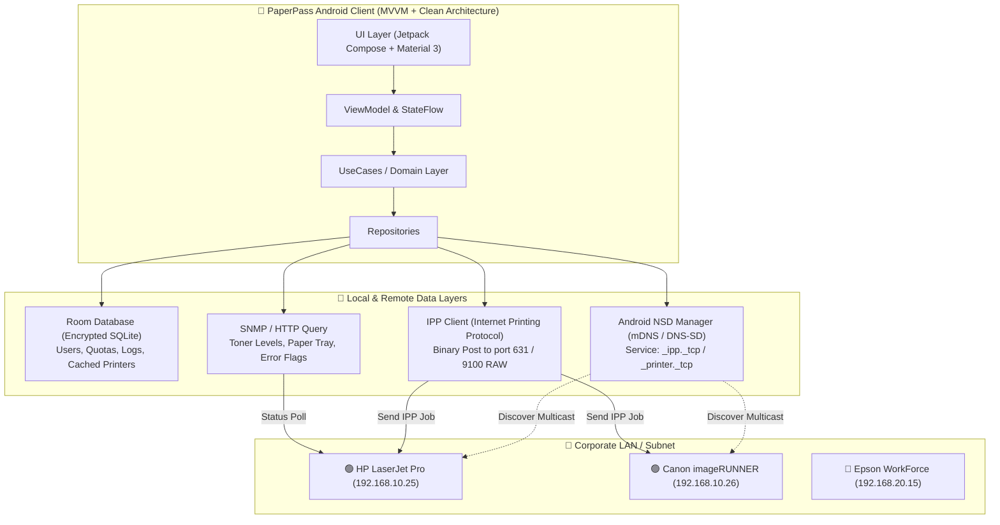
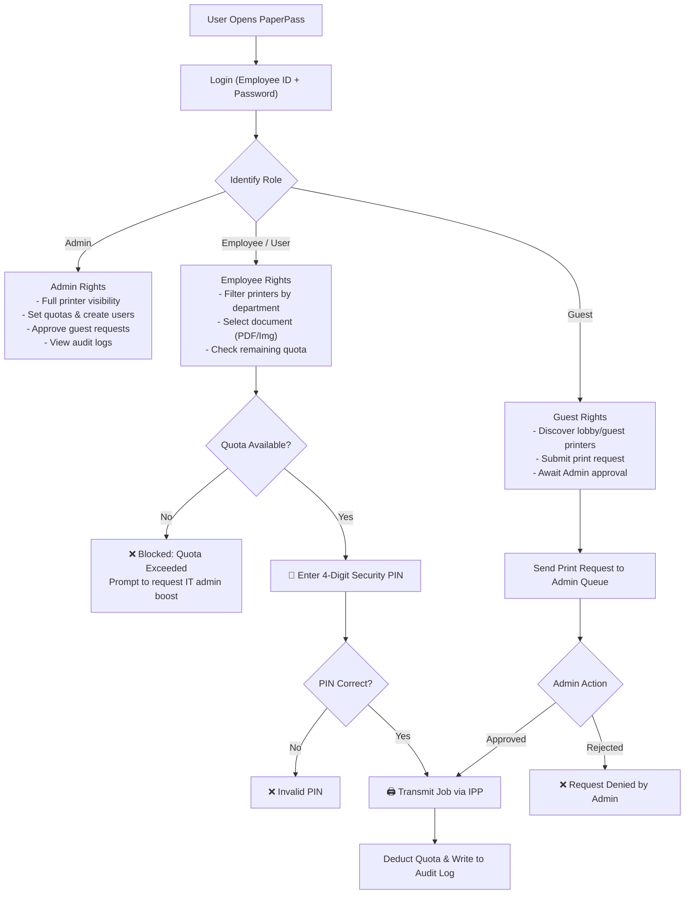
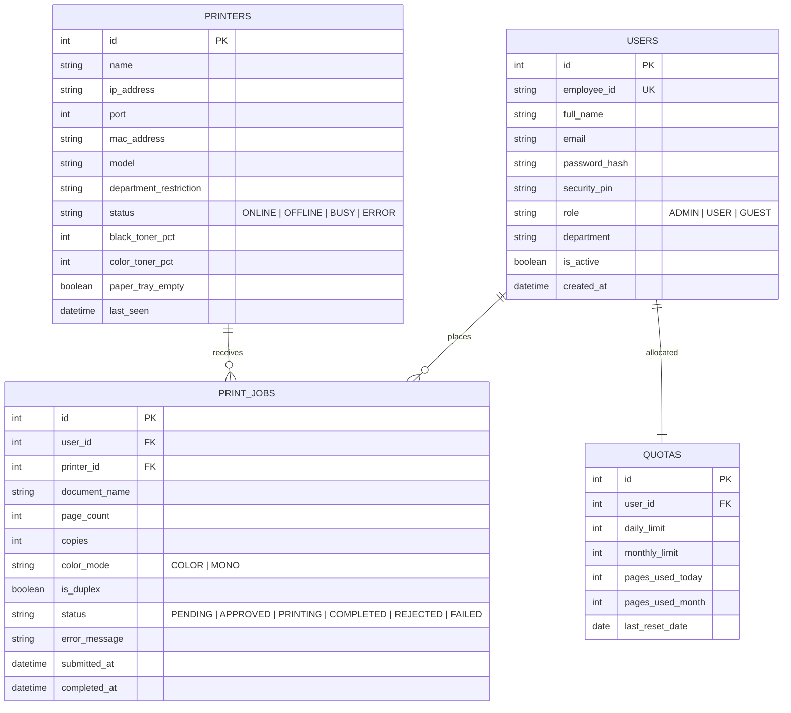
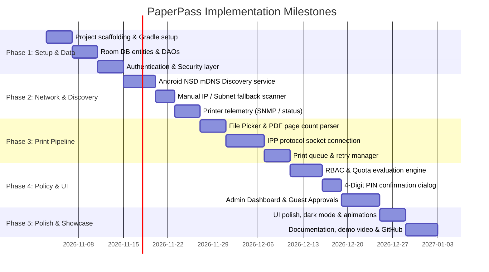

# 🖨️ PaperPass — Secure Network Printer Discovery & Access Management

> **Tagline:** *Zero Unauthorized Prints. Total LAN Visibility.*  
> **Target Audience:** Corporate Offices, Educational Labs, Co-working Spaces, Enterprise IT  
> **Primary Roles Targeted:** Network Engineer, NOC Analyst, IT Officer / IT Executive, Android Solutions Developer

---

## 📌 1. Project Overview

**PaperPass** is a production-grade Android application designed to discover network-attached printers on a local area network (LAN) and enforce **strict authentication, role-based access control (RBAC), and usage quotas** before any document is physically released to print.

In traditional office setups, any device connected to the office WiFi can broadcast print jobs, causing:
1. **Paper & Toner Waste:** Unmonitored personal and accidental prints.
2. **Confidentiality Breaches:** Sensitive documents sitting unattended on printer trays.
3. **Bandwidth & Device Abuse:** Unregistered guests and unauthorized staff over-utilizing heavy-duty office printers.

**PaperPass solves this** by acting as an intelligent mobile gateway and policy enforcer:
- **Discovers** LAN printers dynamically via **mDNS / Bonjour (Android NSD)**.
- **Authenticates** users via Employee ID + Password.
- **Secures** print jobs using an on-demand **4-digit PIN confirmation** or Admin Approval.
- **Enforces** department restrictions and daily/monthly page quotas.
- **Audits** all print operations for IT reporting.

---

## 🏗️ 2. High-Level System Architecture



---

## 🔐 3. Access Control & Authorization (RBAC)



### Role Matrix

| Capability | Admin | Employee (User) | Guest |
| :--- | :---: | :---: | :---: |
| **Scan LAN for Printers** | ✅ All Subnets | ✅ Assigned Dept | ✅ Guest Subnet |
| **Print Directly (with PIN)** | ✅ Unlimited | ✅ Within Quota | ❌ (Request Only) |
| **Bypass Quota Limits** | ✅ Yes | ❌ No | ❌ No |
| **Approve Guest Requests** | ✅ Yes | ❌ No | ❌ No |
| **Manage Users & Reset PINs** | ✅ Yes | ❌ No | ❌ No |
| **Export Audit Logs (CSV)** | ✅ Yes | ❌ No | ❌ No |

---

## 📱 4. Key UI Screens & Wireframes

### Screen 1: Login & Identity Verification
* **Purpose:** Ensure only authorized personnel connect to printer queues.
* **UI Elements:**
  * App Banner: `PaperPass` with stylized lock + printer emblem.
  * Inputs: `Employee ID / Username`, `Password`.
  * Biometric Prompt option (Fingerprint / Face Unlock).
  * Quick links: *Guest Access Request*, *Forgot PIN*.

### Screen 2: Central Dashboard
* **Metrics Header:**
  * Network Status: Connected SSID, Gateway IP, Active Subnet.
  * Personal Quota Progress Bar: `38 / 50 pages used today`.
  * Quick Status Chips: `4 Printers Online`, `1 Needs Paper`.
* **Discovered Printers Carousel / List:**
  * Card view showing: Printer Name, IP, Department tag (`HR`, `Engineering`, `General`), Ink gauge, Online/Offline badge.
* **Floating Action Button (FAB):** `+ Quick Print Document`.

### Screen 3: Print Configuration & Security Release
* **File Preview:** File name, file size, thumbnail, calculated page count.
* **Print Settings:**
  * Copies selector (`-` `+`).
  * Color Profile: Monochrome (B&W) / Full Color.
  * Duplex: Single-sided / Double-sided (Long Edge / Short Edge).
  * Page Range: `All` or comma-separated `1-3, 5`.
* **Security Check:**
  * Dynamic calculation: `Remaining: 12 pages` $\rightarrow$ `After Job: 8 pages`.
  * 4-Digit Boxed PIN Entry widget.
  * Button: `[ 🖨️ Authorize & Print ]`.

### Screen 4: IT Administrator Console
* **Navigation Tabs:** `Overview`, `Users`, `Printer ACLs`, `Pending Requests`.
* **Pending Requests Queue:** Shows live guest requests with document name, requester name, timestamp, and instant `[Approve]` / `[Decline]` triggers.
* **Audit Trail Table:** Real-time stream of `{timestamp, user, printer, page_count, status}`.

---

## 🗄️ 5. Database Schema (Room / SQLite)



---

## 📁 6. Android Project Directory Structure

```
PaperPass/
├── app/
│   ├── build.gradle.kts
│   ├── proguard-rules.pro
│   └── src/
│       ├── main/
│       │   ├── AndroidManifest.xml
│       │   ├── java/com/shakib/paperpass/
│       │   │   ├── PaperPassApp.kt                # Application class (Hilt initialization)
│       │   │   ├── MainActivity.kt                # Single activity hosting Compose Nav
│       │   │   │
│       │   │   ├── core/                          # Cross-cutting utilities
│       │   │   │   ├── network/                   # Network monitoring & connectivity state
│       │   │   │   │   ├── NetworkMonitor.kt
│       │   │   │   │   └── SubnetScanner.kt
│       │   │   │   ├── security/                  # Cryptography & Hashing
│       │   │   │   │   ├── PasswordHasher.kt      # BCrypt / PBKDF2
│       │   │   │   │   └── PinValidator.kt
│       │   │   │   └── util/
│       │   │   │       ├── Resource.kt
│       │   │   │       └── Extensions.kt
│       │   │   │
│       │   │   ├── data/                          # Data Layer implementation
│       │   │   │   ├── local/
│       │   │   │   │   ├── AppDatabase.kt
│       │   │   │   │   ├── dao/
│       │   │   │   │   │   ├── UserDao.kt
│       │   │   │   │   │   ├── PrinterDao.kt
│       │   │   │   │   │   ├── PrintJobDao.kt
│       │   │   │   │   │   └── QuotaDao.kt
│       │   │   │   │   └── entity/
│       │   │   │   │       ├── UserEntity.kt
│       │   │   │   │       ├── PrinterEntity.kt
│       │   │   │   │       ├── PrintJobEntity.kt
│       │   │   │   │       └── QuotaEntity.kt
│       │   │   │   ├── network/
│       │   │   │   │   ├── nsd/                   # mDNS / DNS-SD Service Discovery
│       │   │   │   │   │   ├── NsdPrinterDiscovery.kt
│       │   │   │   │   │   └── PrinterServiceInfoParser.kt
│       │   │   │   │   ├── ipp/                   # IPP binary protocol handler
│       │   │   │   │   │   ├── IppClient.kt
│       │   │   │   │   │   └── IppJobBuilder.kt
│       │   │   │   │   └── snmp/                  # Printer hardware telemetry
│       │   │   │   │       └── SnmpManager.kt
│       │   │   │   └── repository/
│       │   │   │       ├── AuthRepositoryImpl.kt
│       │   │   │       ├── PrinterRepositoryImpl.kt
│       │   │   │       ├── PrintJobRepositoryImpl.kt
│       │   │   │       └── QuotaRepositoryImpl.kt
│       │   │   │
│       │   │   ├── domain/                        # Business Logic & Interfaces
│       │   │   │   ├── model/
│       │   │   │   │   ├── User.kt
│       │   │   │   │   ├── Printer.kt
│       │   │   │   │   ├── PrintJob.kt
│       │   │   │   │   └── Quota.kt
│       │   │   │   ├── repository/
│       │   │   │   │   ├── AuthRepository.kt
│       │   │   │   │   ├── PrinterRepository.kt
│       │   │   │   │   ├── PrintJobRepository.kt
│       │   │   │   │   └── QuotaRepository.kt
│       │   │   │   └── usecase/
│       │   │   │       ├── DiscoverPrintersUseCase.kt
│       │   │   │       ├── AuthenticateUserUseCase.kt
│       │   │   │       ├── AuthorizeAndPrintUseCase.kt
│       │   │   │       ├── EvaluateQuotaUseCase.kt
│       │   │   │       └── ManageGuestRequestsUseCase.kt
│       │   │   │
│       │   │   ├── presentation/                  # UI Components (Jetpack Compose)
│       │   │   │   ├── navigation/
│       │   │   │   │   ├── Screen.kt
│       │   │   │   │   └── NavGraph.kt
│       │   │   │   ├── theme/
│       │   │   │   │   ├── Color.kt
│       │   │   │   │   ├── Theme.kt
│       │   │   │   │   └── Type.kt
│       │   │   │   ├── components/
│       │   │   │   │   ├── PrinterCard.kt
│       │   │   │   │   ├── PinKeypadDialog.kt
│       │   │   │   │   ├── TonerGauge.kt
│       │   │   │   │   ├── QuotaBadge.kt
│       │   │   │   │   └── CustomTopAppBar.kt
│       │   │   │   └── screens/
│       │   │   │       ├── auth/
│       │   │   │       │   ├── LoginScreen.kt
│       │   │   │       │   └── LoginViewModel.kt
│       │   │   │       ├── dashboard/
│       │   │   │       │   ├── DashboardScreen.kt
│       │   │   │       │   └── DashboardViewModel.kt
│       │   │   │       ├── print/
│       │   │   │       │   ├── PrintConfigScreen.kt
│       │   │   │       │   └── PrintConfigViewModel.kt
│       │   │   │       ├── history/
│       │   │   │       │   ├── PrintHistoryScreen.kt
│       │   │   │       │   └── PrintHistoryViewModel.kt
│       │   │   │       └── admin/
│       │   │   │           ├── AdminPanelScreen.kt
│       │   │   │           ├── UserManagementTab.kt
│       │   │   │           ├── RequestsApprovalTab.kt
│       │   │   │           └── AdminViewModel.kt
│       │   │   │
│       │   │   └── di/                            # Dependency Injection (Hilt)
│       │   │       ├── DatabaseModule.kt
│       │   │       ├── NetworkModule.kt
│       │   │       └── RepositoryModule.kt
│       │   │
│       │   └── res/
│       │       ├── drawable/
│       │       ├── values/
│       │       │   ├── strings.xml
│       │       │   └── colors.xml
│       │       └── xml/
│       │           └── network_security_config.xml
│       │
│       └── test/                                  # Unit tests (Robolectric / MockK)
├── build.gradle.kts
├── settings.gradle.kts
├── plan.md                                        # This architecture master plan
└── README.md
```

---

## 🛠️ 7. Detailed Tech Stack & Dependencies

| Area | Component | Implementation / Library | Justification |
| :--- | :--- | :--- | :--- |
| **Language** | Kotlin 1.9+ | Modern, concise, null-safe | Android standard |
| **UI Framework** | Jetpack Compose | Material 3 Components | Modern declarative UI, effortless reactive updates |
| **Architecture** | Clean Architecture | MVVM + Repository Pattern | Decoupled UI and business logic for easy testing |
| **Dependency Injection**| Dagger Hilt | `hilt-android`, `hilt-compiler` | Industry standard, modular testability |
| **Local Persistence** | Room Database | `androidx.room:room-ktx` | Type-safe SQLite persistence with Flow integration |
| **Device Discovery** | Android NSD API | `android.net.nsd.NsdManager` | Native zero-configuration mDNS discovery |
| **Print Protocol** | IPP Client | Binary IPP parser / `jipp` | RFC 8011 compliant printing over IP |
| **Security & Auth** | Hashing & Biometrics | BCrypt / `androidx.biometric` | Secure credential hashing and hardware fingerprint auth |
| **Asynchronous Engine**| Coroutines & Flow | `kotlinx-coroutines-core` | Non-blocking socket I/O and reactive UI streams |
| **Document Parsing** | Android Storage Access | `ActivityResultContracts.GetContent` | Safe handling of PDF / Image streams |

---

## 📅 8. Step-by-Step Implementation Roadmap



---

## 💼 9. Resume & Interview Value Proposition

### How to Describe PaperPass on Your Resume:
> **PaperPass — Enterprise Mobile Print & Access Management Platform (Android / Kotlin)**  
> *Developed a secure Android network printing application featuring mDNS-based automated printer discovery and role-based access control (RBAC).*  
> - Designed an mDNS service discovery engine utilizing Android's `NsdManager` to detect LAN printers across subnets without hardcoded IPs.  
> - Implemented an access gatekeeper enforcing 4-digit PIN confirmation, department-level ACLs, and quota limits to eliminate unauthorized and accidental prints.  
> - Engineered an IPP (Internet Printing Protocol) driver pipeline to serialize PDF and document payloads directly to network-attached printers over TCP port 631.  
> - Built an Administrative dashboard managing real-time guest print approvals, device telemetry (toner/paper status), and compliance audit trails.  
> - **Tech Stack:** Kotlin, Jetpack Compose, Material 3, Room DB, Hilt, Coroutines/Flow, Android NSD, IPP RFC 8011, BCrypt.

### Questions Interviewers Will Ask You:
1. **"How does mDNS discovery work in an enterprise subnet that blocks multicast?"**  
   *Answer:* "Standard mDNS uses multicast address `224.0.0.251` on UDP port `5353`, which routers usually don't cross between VLANs. In PaperPass, I implemented Android's `NsdManager` for local broadcast domains, but added an explicit **Manual IP & Direct Subnet Scan fallback** using socket connectivity tests to bridge cross-VLAN printers."
2. **"How do you prevent someone from tampering with their quota on their phone?"**  
   *Answer:* "In the local MVP version, the database can use SQLCipher with Android Keystore backed encryption. In a multi-user corporate deployment, the app syncs against a central verification endpoint, while the local Room DB acts as an offline cache with cryptographic checksums."

